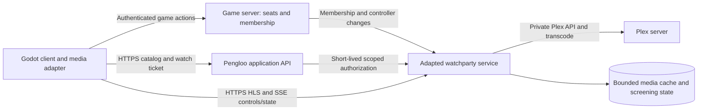

# Cinema - Plex Watchparty Integration Plan

[Dev Handoff - Start Here](Dev%20Handoff%20-%20Start%20Here.md) · [Dev Handoff - Server and Deployment](Dev%20Handoff%20-%20Server%20and%20Deployment.md) · [Dev Handoff - Self Hosting and Browser Release](Dev%20Handoff%20-%20Self%20Hosting%20and%20Browser%20Release.md)

## Decision and recommendation

Use rawsocket-dev/plex-watchparty as the engineering base, as requested. Plex, Emby and Jellyfin are candidate sources; select the first live adapter based on the available server. Adapt its media service and synchronization code while keeping Pengloo's world, seats, identity and UI separate. Start with one shared screening, explicitly scoped to one cinema instance. Prove browser playback and native decoding early; do not equate a working watchparty webpage with a finished in-game cinema.

This is an implementation plan, not a deployment. No Plex credentials, live library, streaming server or game player have been configured. The original game design brief remains unchanged.

## Evidence reviewed

Reviewed upstream commit `b1c1ceccda030a2f03128baad98c7c3daf8893c3` on 2026-10-24. Ran `go test ./...` in the isolated source checkout: passed. This verifies upstream automated tests only, not real Plex playback, authorization in Pengloo, network conditions or client exports. The module requests Go 1.26.3.

The upstream service supplies Plex browsing, HLS proxy/cache, host-controlled synchronization and a browser player. It has a single active playback hub/process. Keep its MIT copyright/license notice when adapting code. [Upstream repository and license](https://github.com/rawsocket-dev/plex-watchparty).

Current local game inspection: `scripts/cinema.gd` constructs the cinema, discovers screen/seat sockets and defines lobby/auditorium voice regions. These are integration points, not evidence of working media playback. Other game work is concurrent; recheck these paths before editing.

## What we reuse and what we change

| Area | Reuse | Required adaptation |
| --- | --- | --- |
| Plex catalog | Movie/TV metadata, artwork/cache, title lookup | Expose approved library items in Pengloo kiosk; preserve source availability/errors |
| Streaming | Plex transcode lifecycle, rewritten HLS playlists, segment disk cache | Game-session authorization; bounded cache; configurable quality; authenticated segment requests |
| Playback control | Playback state, play/pause/seek/load, stream-session restart handling | Screening scope, monotonic revision, command IDs, controller mapping and improved drift handling |
| Presence | SSE roster, reconnect behavior, host handoff | Stable Pengloo player IDs; distinguish in-room, seated, watching and buffering; no seat per browser connection |
| Authentication | Auth guard and CSRF patterns | Replace production Google-email allowlist with game identity adapter; keep operator/admin access separate |
| Web player | HTML video + hls.js and native-HLS fallback | Component without page redirects/global handlers; Pengloo controls and lifecycle; no duplicate decoder/audio |
| Administration | Health/cache observations and operational actions | Restrict to operators; protect credentials; screen-scoped moderation rather than public admin UI |

Specific source touchpoints: [main.go](https://github.com/rawsocket-dev/plex-watchparty/blob/b1c1ceccda030a2f03128baad98c7c3daf8893c3/cmd/plexwatchparty/main.go), [sync.go](https://github.com/rawsocket-dev/plex-watchparty/blob/b1c1ceccda030a2f03128baad98c7c3daf8893c3/cmd/plexwatchparty/sync.go), [player.js](https://github.com/rawsocket-dev/plex-watchparty/blob/b1c1ceccda030a2f03128baad98c7c3daf8893c3/cmd/plexwatchparty/web/player.js), [auth.go](https://github.com/rawsocket-dev/plex-watchparty/blob/b1c1ceccda030a2f03128baad98c7c3daf8893c3/cmd/plexwatchparty/auth.go).

## Target experience

1. Walk into the lobby and interact with the kiosk. Browse real titles/posters; clearly show unavailable source and empty library states.
2. Controller selects a film. Other players can see the selection; voting/queues are later optional additions.
3. Enter the auditorium and claim a seat through the game server. Show who is seated and who is actually ready to watch.
4. Click Watch to enter a clean close-up player while staying connected to the game, voice room and seat. Keep a visible return-to-room/leave-seat control, independent movie and voice volume, captions and compact participant strip.
5. Room view shows seated penguins and the screen. The final target includes actual moving video on the 3D screen. A poster/now-playing stand-in is acceptable only during the technical spike and must not be called full cinema completion.
6. Late joiners receive current state and catch up. Leaving tears down media and releases the seat without affecting other viewers. Switching between room/watch views must reuse the same playback session and emit audio once.

## Architecture on our own server

Game server owns seat occupancy and room membership. Media service owns playback timeline, selected title and stream generation. Pengloo's server establishes who may control; the media service verifies that grant for every mutation. Replicate media status into the game as a projection, not a second competing playback clock. Media never travels through the game RPC transport.

Proposed public path: `https://pengloo.party/cinema/`, reverse-proxied to the private media service. This path is NOT drop-in: upstream uses root-relative `/api`, `/events`, `/control`, `/hls`, `/static` and redirects. Add a configurable base path and update templates, fetch/EventSource calls, playlist URLs, cookies and redirects together. Avoid collision with the game's `/api/` routes. An isolated subdomain is an alternate prototype topology, but requires explicit cross-origin/session handling for integration.

Disable reverse-proxy buffering on SSE, set compatible idle timeouts and forward trusted public-host headers. Keep HLS responses authorized and do not put them into an unscoped public cache. Internal segment cache may be shared across authorized viewers. Only the proxy should expose the service; keep Plex private.

## Client playback: two adapters, one contract

Godot's core VideoStreamPlayer supports Ogg Theora, not the HLS/H.264 stream supplied here. A SubViewport alone does not add a decoder. [Godot video documentation](https://docs.godotengine.org/en/stable/tutorials/animation/playing_videos.html).

| Target | Proposed implementation | Proof needed |
| --- | --- | --- |
| Browser close watch view | HTML video/hls.js component over the game canvas, controlled through JavaScriptBridge | HLS authentication, click-to-play, resize/fullscreen, input focus, captions and cleanup while game connection stays alive |
| Browser world screen | Feed decoded browser video into a Godot-visible texture through an explicit integration | Prototype texture transfer/render path; measure copies, CPU/GPU, color/aspect ratio, cross-origin restrictions and Compatibility renderer behavior |
| Native desktop | GDExtension-backed decoder/render adapter; evaluate libmpv first | HLS, auth headers, seeking, audio control and texture output on each supported OS/renderer; packaged dependencies and license requirements |

JavaScriptBridge connects web-export GDScript to the embedding page's JavaScript; it does not automatically convert HTML video into a Godot texture. Keep callbacks alive and clean them up with the player. [Godot JavaScript bridge](https://docs.godotengine.org/en/stable/tutorials/platform/web/javascript_bridge.html).

libmpv provides a render API and OpenGL integration primitives, making it a candidate to evaluate—not a verified Godot plugin or a guaranteed match for the current renderer. Renderer/thread ownership, texture sharing or frame copies, and platform packaging are explicit spike tasks. [libmpv render API](https://github.com/mpv-player/mpv/blob/master/include/mpv/render.h) and [OpenGL API](https://github.com/mpv-player/mpv/blob/master/include/mpv/render_gl.h).

Do not launch an external browser as the final desktop experience. A separate browser window can validate the backend only. A webview is an alternative native candidate if decoder integration fails, but also requires tested embedding, media support, packaging and license review.

Proposed player interface: `open_session`, `apply_snapshot`, `request_play/pause/seek`, `set_volume`, `set_subtitle_track`, `set_view_mode`, `close`. Events: ready, user-gesture-required, buffering, playing, paused, error, ended, local-position and source-generation-changed. Both adapters consume the same screening state and permissions.

## Session and identity contract

Proposed new API, not existing upstream endpoints:

- `POST /api/cinema/{screeningId}/join`: authenticate game player; check cinema membership/access; return scoped watch authorization and current state.
- Browser exchanges a short-lived single-use ticket over HTTPS POST for an HttpOnly secure media session cookie. Native uses a short-lived bearer credential supported by its adapter. Do not include Plex tokens or reusable credentials in world snapshots or URLs.
- Authorize catalog, state, controls, playlist and EVERY segment request. Scope grants to player, screening, role, expiry and session generation; revoke/expire on leaving or removal. Define refresh for long movies.
- Game membership changes flow through an authenticated server-to-server channel. Never accept a client-supplied controller role or player ID as authority.
- State: screeningId, mediaId, streamGeneration, revision, playing, positionSeconds, serverTimestamp, duration, controllerPlayerId and public watcher states. Internal Plex references stay behind the adapter where possible.
- Commands carry requestId, expected generation/revision and action. Reject unauthorized/stale commands. A repeated seek/load should not restart transcoding repeatedly.

Upstream endpoints include `/api/library`, `/api/movies`, `/api/state`, `/events`, `/control`, `/api/host/handoff`, `/hls/index.m3u8` and `/hls/seg/`. Preserve their useful implementation behind the adapted contract; changing a URL prefix does not itself establish game authorization.

## Synchronization changes we should make

Upstream player hard-seeks viewers when drift exceeds 0.75 seconds and periodically checks drift; the active host is exempt from ongoing correction. Its source comments note that periodic host-position broadcasting was removed because unstable player readings caused repeated seeks. Therefore passing tests does not prove long-duration host/viewer agreement. [Reviewed player implementation](https://github.com/rawsocket-dev/plex-watchparty/blob/b1c1ceccda030a2f03128baad98c7c3daf8893c3/cmd/plexwatchparty/web/player.js).

Keep one server timeline with explicit controller commands. Apply the same timeline to host and viewers after a local-command grace window. Do not reinterpret every decoder seek/time event as a group seek. Use clock-offset estimates, generation/revision checks, bounded correction and a buffering policy. Trial small playback-rate adjustment for modest drift and seek for large drift; validate actual behavior with both decoders before fixing thresholds.

Proposal: an individual slow viewer buffers/catches up without pausing everybody. Controller can pause for everyone. After controller disconnect grace, pause and transfer to an eligible remaining player, or remain paused until one is authorized. Make this explicit in UI. Reconcile upstream host handoff with the game's role policy rather than letting two services independently elect controllers.

New stream generation after a forward seek/title change must invalidate old pending responses and remount the player only when needed. Preserve cache-backed backward seeks. Account for transcode startup delay with a shared Preparing/Seeking state rather than claiming instant seeking.

## Missing features and concrete review findings

- Upstream initializes one Hub and one PlexSession in main.go. First release can use one screening; simultaneous private/world screenings require a keyed manager and isolated state, host, cache/session routing and persistence. Do not let independent worlds unknowingly share one movie.
- Upstream requests H.264/AAC HLS, disables direct play/stream, chooses media/part index zero and sets subtitles to none. Add actual track enumeration/selection, subtitle delivery or deliberate burn-in policy, and tests for supported sources. Language/subtitle choices that restart a shared transcode affect everyone; per-user captions need a separate track path. [Transcode code](https://github.com/rawsocket-dev/plex-watchparty/blob/b1c1ceccda030a2f03128baad98c7c3daf8893c3/cmd/plexwatchparty/plex_session.go).
- Upstream's Plex HTTP transport disables certificate verification and is also reused by its IMDb HTTP client in the reviewed code. Replace that with verified TLS by default and separate external-client configuration; do not carry that setting into deployment indiscriminately. [Plex client construction](https://github.com/rawsocket-dev/plex-watchparty/blob/b1c1ceccda030a2f03128baad98c7c3daf8893c3/cmd/plexwatchparty/plex.go).
- Google allowlists are useful for an isolated initial test, but must not be confused with Pengloo identity. No secret-bearing config belongs in the game export or Git.
- Upstream is one package main, not a drop-in Godot library. Initially vendor a pinned adapted service with attribution and documented changes; extract reusable modules only as needed. Track upstream fixes deliberately instead of deploying floating latest images.

## Server budget and deployment checklist

Need a reachable Plex instance with a playable test title, server-side token installed by the operator, supported transcoding capacity, server OS/hardware, upload bandwidth, DNS/reverse-proxy access and expected simultaneous viewers. No credentials need to be pasted into chat.

At a proposed 6 Mbps per viewer, eight simultaneous viewers require about 48 Mbps outbound video traffic plus overhead, voice and game traffic. A shared transcode/cache reduces repeated Plex work, not per-viewer internet egress. A two-hour stream at 6 Mbps is about 5.4 GB; cache limits and eviction must be deliberate. These are arithmetic planning examples, not measured throughput or chosen settings. Test a lower-bitrate profile as well as the intended quality.

Use persistent directories for resume/control data and a bounded, replaceable segment cache. Pin release images, isolate secrets and expose readiness plus cache/transcode/bandwidth metrics. Test shutdown and resume; an old saved position is not evidence that all viewers are still connected. Keep operator console private.

Web builds require Compatibility rendering; evaluate single-thread export first and retest media headers if threaded isolation is later enabled. [Godot web export constraints](https://docs.godotengine.org/en/stable/tutorials/export/exporting_for_web.html).

## Implementation sequence and completion gates

1. **Pinned backend baseline:** retain upstream license; run unit tests; start isolated instance against a real test library. Two browsers on different networks can browse/play/pause/seek/late-join. Record codec, bitrate and transcode hardware behavior.
2. **Player feasibility gate:** a minimal Godot web scene launches the embedded player and preserves its connection/input lifecycle. Native spike decodes the SAME authenticated HLS stream and supplies a usable texture. Demonstrate browser world-screen transfer separately. Do not polish the cinema before this gate identifies platform limits.
3. **Identity and screening scope:** implement join-ticket exchange, game membership/controller grants, endpoint authorization, revocation, command revisions and one explicitly scoped screening. Negative tests cover missing ticket, forged roles, stale generation and access after departure.
4. **Kiosk and seats:** wire real catalog/posters to kiosk, seat claim to watching join, room/watch views to one decoder, clean exit and presence states. Verify no duplicate seats/connections after refresh.
5. **Synchronization and accessibility:** fix host drift behavior, implement controller loss policy, add captions/tracks, separate movie/voice volumes, buffering states and reduced-distraction controls.
6. **Release rehearsal:** long mixed native/browser session, remote networks, weak connection, background tab, media outage, restart, cache-full, token expiry and stream change while requests are in flight. Deploy only after measured results meet the gates.

Proposed acceptance target: once buffering settles, clients stay within roughly 0.5 seconds of the shared timeline for at least a 60-minute mixed-client test. Confirm or adjust this target using measured decoder behavior. A paused late join remains paused at the agreed position. Every controller action changes state once. Unauthorized clients cannot fetch a segment. Leaving restores movement/voice context and produces no lingering movie audio. All supported clients must play real media—not only posters or a demo shader.

## Next concrete action

Build the isolated backend + minimal player feasibility test first. Operational inputs needed for the live phase: where Plex runs/reachability from the game server, server OS/CPU/GPU and upload speed, intended initial viewer count, and which desktop operating systems must ship. Those details do not block the adapter/interface work, but they do block an honest end-to-end performance claim.

## Emby support

Emby can use the same cinema architecture, but upstream plex-watchparty is Plex-specific; changing PLEX_BASE_URL to an Emby server will not work. This is a supported architectural direction, not implemented compatibility or a decision to replace Plex as the first test source.

Introduce a MediaProvider boundary before expanding the fork: list/search catalog, get metadata/artwork, resolve playback for client capabilities, start/seek/stop stream session, enumerate tracks, and report playback lifecycle. Keep provider item IDs and credentials inside the adapter. Use provider + server identity + media ID + stream generation in cache keys to avoid collisions.

Implement PlexProvider from the existing code; add EmbyProvider using Emby's item catalog, PlaybackInfo negotiation and returned stream URLs. Do not copy Plex query parameters, timeline calls or segment assumptions into Emby. Normalize time units (including Emby ticks where returned), durations, track identifiers and stream offsets. The generic layer retains Pengloo identity, seats, controller roles, timeline and player adapters.

Emby's PlaybackInfo API supplies media-source/playback information including TranscodingUrl; its HLS documentation requires stopping associated transcoding when playback ends. Use those APIs rather than synthesizing Plex-like stream URLs. [Emby PlaybackInfo](https://dev.emby.media/reference/RestAPI/MediaInfoService/postItemsByIdPlaybackinfo.html) and [Emby HLS](https://dev.emby.media/doc/restapi/Http-Live-Streaming.html).

Server-side API-key authentication is available; constrain the exposed library through the gateway and selected access policy, and keep the credential out of clients. [Emby API-key authentication](https://dev.emby.media/doc/restapi/API-Key-Authentication.html).

Add an Emby-specific real-server test for catalog access, HLS playback, seek/restart, track selection, permissions, disconnect cleanup and late join. Verify the actual server version and transcoding setup; Plex unit tests do not establish Emby compatibility. If Emby is the server already available, it can become the first live adapter target while still reusing the watchparty design.

## Jellyfin support and final provider choice

Jellyfin is also a viable source. Add a separate JellyfinProvider behind the same interface rather than assuming Emby API compatibility. Its official SDK exposes PlaybackInfo negotiation and playback-progress models; use the actual supported server/API version for media-source selection, authorization, track handling and session cleanup. [Jellyfin MediaInfo API](https://typescript-sdk.jellyfin.org/classes/generated-client.MediaInfoApi.html) and [playback progress](https://typescript-sdk.jellyfin.org/interfaces/generated-client.PlaybackProgressInfo.html).

The user has raised Plex, Emby and Jellyfin as options. The selected engineering base is plex-watchparty; the first live provider is now open pending the available server. Keep one Pengloo playback/control contract and three explicit provider adapters. Implement and verify one adapter end to end first, then extend using the same acceptance suite. Do not implement competing provider-level synchronization alongside Pengloo's timeline without a deliberate authority decision.

For Jellyfin, prove authorized catalog/poster access, negotiated browser-compatible stream, native playback, stream proxy rewriting, subtitle/audio selection, seek offsets, progress/stop reporting, expiry/reconnect and cross-user access restrictions. Run a provider-specific integration suite; shared ancestry with Emby is not proof of interchangeable APIs or tokens.
