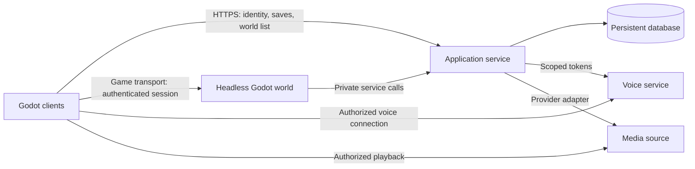

# Server and Deployment

[Dev Handoff - Start Here](Dev%20Handoff%20-%20Start%20Here.md) · [Dev Handoff - Data and Network Contracts](Dev%20Handoff%20-%20Data%20and%20Network%20Contracts.md)

## Recommended initial architecture — proposal

Build native and eventual browser clients backed by one authoritative headless Godot game server per world process on the team’s own server. See [Dev Handoff - Self Hosting and Browser Release](Dev%20Handoff%20-%20Self%20Hosting%20and%20Browser%20Release.md) for the confirmed hosting/platform requirements and early compatibility proof. Add a small HTTPS application service for identity, world discovery/join tickets, saves and external-service tokens. Use a persistent relational store for profiles, home layouts and ownership. Start with one application service and one database, not a fleet of microservices. A single host may run the prototype components, provided a game-process restart cannot erase persistent data.

### What belongs where

Client: input, responsive presentation, animation, camera, UI, local audio mixing. Game server: room membership, occupancy, match state, validated actions, timers, hits/scores and authoritative results. Application service: stable identity, permissions, persistence, discoverable world metadata, short-lived join authorization and secret-bearing integrations. Database: durable records only, not every frame of movement. Voice/media: separate transport from gameplay.

Godot supports headless execution and dedicated-server exports; choose a server entry scene that initializes simulation without UI, rendering-dependent code, microphone capture or client movie playback. Keep server collision and gameplay resources even when visual assets are stripped. [Godot dedicated-server export documentation](https://docs.godotengine.org/en/stable/tutorials/export/exporting_for_dedicated_servers.html).

The current native ENet approach uses UDP; an HTTPS reverse proxy is not a substitute for exposing the game transport. Validate the chosen port/firewall path from an external network. Browser clients are a confirmed future requirement: evaluate a common WebSocket/WebRTC transport and browser constraints before selecting the production network stack. ENet and browser peers are not automatically interoperable. [Godot 4.7 multiplayer documentation](https://docs.godotengine.org/en/4.7/tutorials/networking/high_level_multiplayer.html).

## Bootstrap and join flow

1. Client establishes an identity with the application service; a stable guest ID is sufficient for an invite-only prototype if its loss/recovery policy is explicit.
2. Client requests available worlds. Each record includes ID, display name, endpoint, build/protocol version, current occupancy, capacity and accepting-joins flag.
3. Client requests a join ticket for a world. Service validates access and capacity and returns a short-lived ticket bound to player, world and compatible build.
4. Client connects to the game endpoint and submits the ticket. Server validates it before accepting gameplay RPCs. Tickets must not be reusable to impersonate another player.
5. Server reserves capacity, sends authoritative room/session snapshot and spawn, and marks presence active after readiness. Failed joins release reservations.
6. On disconnect, preserve an optional bounded reconnect lease; expire it reliably. Reconnect restores the same identity and current valid state, never duplicates the player or seat.

Do not use peer ID, display name or a client-provided player ID as authentication. The game server's role remains authority even if the first player disconnects; a cinema's playback controller is a different concept from server ownership.

## Identity and persistence choices

Proposed prototype: invite-only guest identities plus persistent device credential. The team must decide whether cross-device recovery/account login is needed. Public accounts require a real authentication and recovery flow, not a custom plaintext password table. Save appearance and homes through authenticated, revision-checked transactions. Do not put database credentials or privileged provider tokens in the Godot client.

## Voice and cinema integration

Select a voice provider or a maintained self-hosted voice stack only after native and browser capture/playback proofs work across two networks. Required capabilities: microphone permission/device selection, mute, positional/room routing, per-user volume and reconnect. Use short-lived room-scoped credentials. Specify relay/NAT traversal and supported platforms during provider evaluation. Quiet drawing rounds must preserve prior mute intent.

Cinema needs both metadata browsing and authorized playable media on EVERY participant's machine. A local server URL reachable only from the host is insufficient. Choose provider and player pipeline early; verify formats/codecs, authorization, buffering and late join. A source-specific adapter maps library IDs to approved playback URLs. Keep broad media credentials private, and never act as an unrestricted URL fetch proxy. Connection state and demo mode must be truthful. Do not promise an untested provider SDK works in native Godot.

## Deployment contract

Required configurable values: environment name, public API origin, game bind/public endpoints and port, world ID, capacity, protocol/build ID, database connection, join-ticket verification material, voice/media provider configuration and log level. Name them consistently in an example config with placeholders; actual secrets live in deployment secret storage. No config or infrastructure has been provisioned by this document.

A release produces pinned client and server artifacts, checksums, database migration version and rollback reference. Pin the same Godot release/export templates on build machines and CI. Run the server as an unprivileged service with restart supervision, persistent data outside the binary/container, bounded logs, health/readiness endpoints and resource limits. Health means process alive; readiness also means dependencies loaded and accepting joins. Mark draining before shutdown, stop new joins, finish/save or explicitly cancel sessions, then exit.

Before a public endpoint: configure domain/TLS for HTTPS, the chosen game transport routing, private DB access, backup schedule and a tested restore. Hosting on the team’s own server is confirmed. Record its OS, hardware, uplink, public connectivity, operator and incident contact; domain and network details remain to establish. Start with one small measured capacity and load-test it; do not infer capacity from mockup numbers.

## Operations and failure behavior

Track build/version, uptime, occupancy, tick overruns, join failures, latency, reconnects, denied actions, save failures and provider failures. Correlate by request/session ID without logging secrets or private drawing contents. On database failure, reject new persistent edits clearly rather than reporting Saved. On server restart, cancel unsupported live matches honestly while retaining durable profiles/homes. Keep backups separate from deployment volumes. Roll back compatible binaries; use forward-safe migrations and restore rehearsal for data failures.

Acceptance: two remote clients join, see the same world, compete for one seat, complete a match, disconnect/reconnect, preserve a saved home across server restart, and receive a useful error when a dependency is unavailable.
