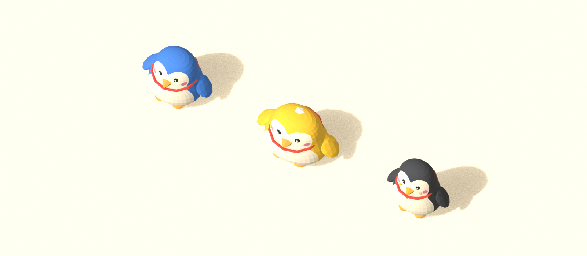
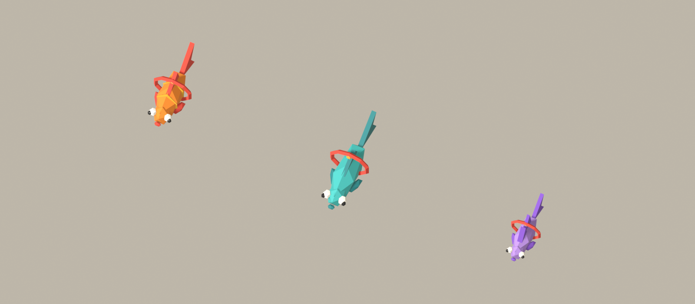
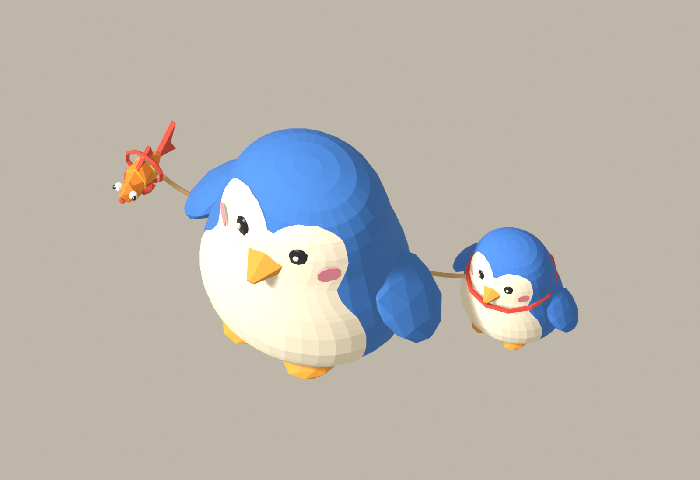

# Pet Kit

Reference: [GAME_DESIGN_CONTEXT](GAME_DESIGN_CONTEXT.md) · [Gallery](Gallery.md) · [Art Pipeline](Art%20Pipeline.md)

The models are in `Models/pets/`, built by `art/blender/kits/pets.py`. Follow, inventory, and clips are not wired up yet.

Chicks are the player bird scaled down, with a collar. Fish are the fishing-kit bodies scaled down, with a collar, so they match the catch shapes without being the trophy mesh.

The leash in the last sheet is drawn for the mockup only. It is not in the GLB. The game draws it from the player's `socket_pet` to the pet's `socket_collar`.

## What they are

The player is the 0.9 m penguin. A pet is a cosmetic companion on a leash, either a smaller penguin or a fish. Pets do not fight, eat, or gate activities. They make a player recognizable the way a hat does, and they give fishing a keepsake that walks around town.

One pet is active at a time. The mockup shows a chick and a fish together so the scale of both kinds is visible; that pair is not the equip default.

## Scale

Measured against `avatar_base` (0.90 m tall, about 0.74 m across the body).

| Pet | Kind | Size | Where it sits |
| --- | --- | --- | --- |
| Pebble | Penguin chick | 0.44 m tall | On the ground, left and a little behind the player |
| Puff | Fluffy chick | 0.42 m tall, wider | Same slot, rounder silhouette |
| Tuxedo | Slim chick | 0.48 m tall, narrower | Same slot, taller silhouette |
| Minnow | Round fish | 0.32 m long | Hovering at 0.36 m, about flipper height |
| Ribbon | Long fish | 0.39 m long, thin | Hovering at 0.34 m |
| Puffer | Spiky fish | 0.26 m long | Hovering at 0.40 m |

Chicks use the player's body colours (`blue`, `green`, `yellow`, `pink`, `red`, `orange`, `purple`, `teal`, `charcoal`, `white`). Fish recolour on `body` and `fin`. A pet can match its owner or contrast with them. One mesh per species, not one mesh per colour.

Caught fish in the fishing kit stay trophies. Pet fish reuse those body shapes at pet scale and add a collar. They should not be the fish hanging on the dock rack.

## The leash

Every pet has `socket_collar`. The proposed player anchor is a new `socket_pet` on the left hip, about (0.22, 0.10, 0.36) m in the avatar's bind pose, so a fishing rod can stay in `socket_hand_R`. The scale sheet uses that hip for the chick and the right flipper for the fish, only so both leads are readable in one picture. In play there is one lead, from `socket_pet` to `socket_collar`.

Slack is about 5 cm of sag. A chick's lead is about 0.9 m before it goes taut; a fish's lead is about 0.8 m. Past that, the pet is pulled along.

## How they follow

Proposed, not built:

- **Chick.** Stands on the ground, about 0.75 m to the player's left and slightly behind. Uses the same walkable ground as the player. Short waddle while the player moves, idle bob when the player stops, a small hop if the lead pulls taut. Sits when the player sits.
- **Fish.** Does not use the navmesh. Springs toward a point about 0.7 m to the player's right, 0.15 m forward, at its hover height. The tail is part of the mesh; a sway clip comes later. The bob gets faster while the player runs. It stays in the air on land and over the dock; it is a pet, not a swimming catch.

Other players see the active pet and its colours. Dismissing a pet puts it away. No second pet trails behind.

## Roster

| Name | Read it as | Notes |
| --- | --- | --- |
| `pet_pebble` | Default blue chick, cream belly, orange beak and feet, red collar with a bell | Starter pet |
| `pet_puff` | Shorter, wider, cream down sticking out | Same rig plan as Pebble, fluffier shell |
| `pet_tuxedo` | Charcoal back, big cream belly, yellow cheek spots | Tallest chick |
| `pet_minnow` | Chubby orange fish, white eyes, red collar | Starter fish, once fishing can award it |
| `pet_ribbon` | Long teal fish, long forked tail | |
| `pet_puffer` | Lavender fish with a tall dorsal | Hovers a little higher |

Pebble is the pet a new player has. The other chicks are cosmetic variants. The fish are a proposed reward for catching that shape, separate from the trophy in the bucket. Nothing here is a shop or a currency.

## Still to build

- `socket_pet` on `avatar_base`, parented to the body bone.
- Clips: chick waddle, idle, sit; fish swim and a faster bob.
- Equip, dismiss, and tint in the same cosmetic flow as hats. One active pet id.
- The live rope between `socket_pet` and `socket_collar`.
- Replication so nearby players see the pet.

The GLBs are the models. Follow behavior is not built.
